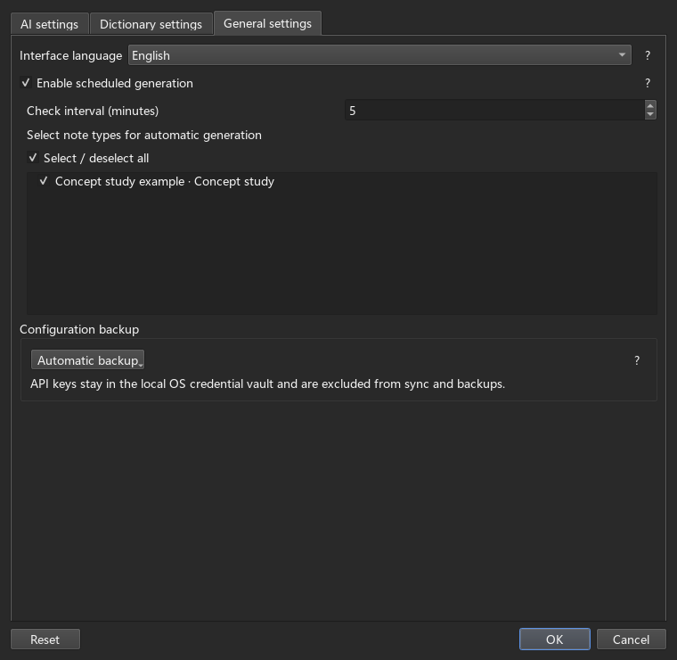

# FastCard Maker User Guide

Based on [FastWordQuery (FastWQ)](https://github.com/sth2018/FastWordQuery), with the original author credits and license retained.

FastCard Maker fills Anki note fields using AI, local MDX dictionaries or online dictionaries. Use them separately, or choose different sources for different fields of the same note. AI can help with concepts, questions and study material as well as vocabulary.

Start with a few notes before running a larger batch. Screenshots use example fields, dictionaries and models; your names may differ.

## 1. Create cards with AI

### Connect an AI service

Open **FastCM → Options → AI settings**:

1. Click **Add profile** and choose a **Provider preset**. Presets are available for OpenAI (ChatGPT), Claude, Gemini, DeepSeek and Qwen. For another compatible service, choose Custom.
2. Give the profile a recognizable name.
3. Enter the **API address**, **API key** and **Model**. The address must include the endpoint path, such as `https://api.deepseek.com/responses`. Preset URLs are editable; use a model supported by your service.
4. Optionally enter shared instructions in **Skill**, such as “Explain clearly and include a concrete example.” Click **OK** to save.


Use **More settings → Custom parameters (JSON)** for reasoning settings. DeepSeek and Qwen both default to **Responses**, with `reasoning.effort` set to `none` in new profiles to disable thinking. Model support for disabling thinking and available levels varies.

These connections also serve dictionary script analysis. Consider a separate “Dictionary parsing” profile with higher reasoning effort for complex scripts. The table contains reasoning settings only; replace the custom parameters with a supported example. Provider names link to official documentation.

| Service and API | Higher-reasoning JSON example |
| --- | --- |
| [OpenAI (Responses)](https://developers.openai.com/api/docs/guides/reasoning) | `{"reasoning":{"effort":"high"}}` |
| [DeepSeek (Responses)](https://api-docs.deepseek.com/guides/responses_api/) | `{"reasoning":{"effort":"high"}}` |
| [Qwen / Model Studio (Responses)](https://help.aliyun.com/zh/model-studio/qwen-api-via-openai-responses) | `{"reasoning":{"effort":"high"}}` |
| [Claude (Messages, adaptive-thinking models)](https://platform.claude.com/docs/en/build-with-claude/adaptive-thinking) | `{"thinking":{"type":"adaptive"},"output_config":{"effort":"high"},"max_tokens":16000}` |
| [Gemini (Interactions)](https://ai.google.dev/api/interactions-api-v1) | `{"generation_config":{"thinking_level":"high"}}` |

Use examples supported by your model; `high` does not imply the same reasoning budget across services. The Claude example retains the required `max_tokens` output limit, which can be adjusted. Older models may need different thinking settings. Higher effort can increase waiting time and token use; click **?** for parameter help.

Region or workspace settings may require a different URL, especially with Model Studio; use the endpoint from your own console.

### Map fields and write prompts

Prepare your notes in Anki first. For a concept example, create `Topic`, `Question`, `Answer` and `Comparison` fields. Enter “Statistics” in Topic and “How do correlation and causation differ?” in Question, leaving the other two for AI.

In **FastCM → Options**, select the corresponding note type:

1. Use the radio button on the left to select Topic as the source field.
2. Keep Topic and Question ignored so their contents are preserved.
3. Uncheck **Ignore** for Answer, choose the saved AI connection as its content source, and enter a prompt.
4. Configure Comparison the same way if needed, with its own prompt. Click **OK** to save the mapping.


Prompts can reference several fields:

```text
Using {{Topic}}, answer this question: {{Question}}
Start with a direct answer, then give one example. Keep it under 150 words.
```

Placeholders are replaced with values from the current note. Field names must match exactly, and referenced fields must not also be AI output fields. Put field references in the field’s prompt rather than Skill.

For Comparison, try `Compare definitions, examples and common misconceptions about {{Question}} in {{Topic}}, using a Markdown table.` Switching the field’s AI connection preserves its prompt.

Vocabulary works the same way: use a word as the source, then request meanings, examples or synonyms in other fields. The add-on fills existing notes. If results do not appear on cards, add the output fields to the relevant Anki card template under **Cards…**.

### Test a few notes, then run a batch

Select a few notes in the Anki Browser and choose **FastCM → Query Selected**. Inspect the results before processing more notes.

For a larger batch, open **FastCM → Query whole note types**, check the required types, choose a saved configuration for each, then click **Query**.


This processes **all notes of the checked types**, regardless of the current deck or Browser selection. Opening from the Browser preselects types represented by selected notes; opening from the main window selects none.

**Skip existing values** controls whether a populated field is queried again. To regenerate one field, clear that option and ignore other targets. Save changes before running the query.

### Sending, formatting and progress

Open **Plugin settings → AI settings**:

- **One request per card** is the default: fields of the same note using the same AI connection share one request, and results are assigned to their respective fields.
- **One request per field** requests each target separately.
- **Render Markdown** converts headings, lists and tables to card HTML; enabled by default.
- **Enable CSS injection** is off by default. Turn it on and select the note types that should use the shared style. **View / edit shared CSS** opens the editor. Styles are added after a query actually writes a note of that type; saving settings alone does not modify card styling.


The shared request rate, timeouts and retries are on this page too. Dictionary threads, matching and cloze format are under **Dictionary settings**; language, scheduling and backups are under **General settings**. Click **?** beside a group for details.

Click **Run in background** to continue using Anki. Reopen **FastCM → Task progress** to inspect status and results; **Finish task** hides the completed progress strip. Results are written about every 30 seconds, with remaining results written when the task finishes.

Closing Anki interrupts the task. If a recovery prompt appears on the next launch, restore replies already received and cached. Unfinished requests are not recovered this way.

### Automatically process new notes

Each note type initially uses its first configuration as the starred configuration. To change it, click another configuration’s star in Options and save.

Under **Plugin settings → General settings**, enable scheduled generation, set the interval, select note types and save. Only empty fields of notes created after enabling the feature are processed. If a batch is still running, the next tick is skipped.


When eligible notes are found, a ten-second countdown offers **Run now** or **Skip this run**. Closing the prompt also skips; leaving it alone starts the batch. Keep Anki open and check Task progress for results.

### Save settings, back up and use another computer

Click **OK** to save changes. Closing an edited settings window asks whether to save; an unchanged window closes immediately.

Under **Plugin settings → General settings → Configuration backup**, choose:

- **Automatic backup**: saving AI connections or current dictionary scripts updates `_fastcm_backup.zip` in the media folder, which syncs with Anki media.
- **Manual backup**: AI connections and scripts stay local; use **Import ZIP / Export ZIP** explicitly, with the media folder as the default location. Export includes saved settings only, so save edits with OK first. Import warns that unsaved changes on the current settings page will be discarded.



The ZIP contains only AI connection settings and current Python dictionary scripts. Ordinary preferences, field mappings and script enable flags are saved in the media folder’s `_fastcmcfg.json`, including in manual backup mode. Dictionary paths stay local.

API keys are stored locally and managed by the operating system. They are not uploaded or synced with your configuration.

In automatic mode, differing settings offer **Overwrite** (local to backup), **Sync** (backup to local) or **Cancel** (keep both for now). Differing scripts use per-file choices, described below.

Backups exclude dictionary files and paths, dictionary JavaScript, conversations and recycled scripts. Add dictionary folders separately on another computer. On first use, current FastCard Maker settings take precedence, with legacy FastWQ settings used when absent; subsequent saves use FastCard Maker filenames.

## 2. Use dictionaries and parser scripts

### Add dictionaries and choose data items

1. Open **FastCM → Options → Dictionary manager → Dictionary folders** and add the folder containing your local dictionaries. Subfolders are supported; keep associated MDD and resource files complete.
2. Under **Local dictionaries**, enable the required dictionaries and save. For online services, enable the corresponding items under **Online dictionaries** instead.
3. In Options, select a source field such as Word. Choose a dictionary and data item for each target, clear Ignore and save.
4. Query a few notes to check text and media before running a batch.


Use default parsing for the complete entry, or a custom parser for separate meanings, examples or pronunciation. Add existing `.py` parsers through **Import script**; placing Python files beside dictionaries does not import them.

New scripts prefer the **MDX filename**, with an optional internal title, rather than a fixed machine path. If a dictionary moves, add its new folder and rescan. Legacy fixed paths and existing audio handling remain supported; filename matching takes precedence when both bindings exist. Multiple matches require you to adjust imported folders rather than silently choosing a file.

Missing dictionaries or scripts keep their original name with a strikethrough in the manager and Options, and queries skip them. Each manager row has a **Delete** button that requires confirmation: missing entries are removed and existing scripts move to the local recycle bin. Options has no delete button. Reselect invalid dictionary data items when needed.

If images or audio fail to import, check MDD/resources first, then try fuzzy media matching under Dictionary settings and inspect the result. Dictionary JavaScript may be changing media paths; try AI parsing below. Missing source media cannot be recreated by a parser.

### Generate or revise a parser with AI

Click **AI parse** beside the dictionary. Use your separate Dictionary parsing profile if available, with reasoning settings supported by its model.

1. Choose an AI profile. Default samples cover a noun (`concept`), verb (`maintain`) and adjective (`relevant`), with alternatives when missing. You can enter three different words found in the dictionary instead.
2. Describe the task in **Command**, for example “Extract meanings, phonetics and pronunciation; check JS audio-path changes and preserve other fields.” Parsing uses this command without the connection’s Skill.
3. Select **Send HTML**, **Send JS** and **Send original script** as needed. Include HTML and JS for audio-path repairs and the original parser when revising one. Missing attachments are skipped.
4. Choose the output mode and click **Send three entries and generate**. Inspect the preview and source, click **Debug** if needed, then **Save script**. Enable it in Dictionary manager and select its data items in your field mapping.


**Return JSON rules** is checked by default: AI describes extraction rules and the add-on generates Python, suitable for standard extraction. Uncheck it for complete Python that can handle complex paths or restructure nested content. Both modes save `.py` files, with matching instructions used for generation and follow-up messages.

Direct Python output receives syntax and structure checks during generation. Clicking Debug or loading a saved script executes code; passing checks does not guarantee correct results.

### Read debug results and continue the conversation

**Debug** checks three samples and adds results and detailed errors to **Information history**. Enter a follow-up below and click **Send message** to ask for changes.


- **Include all messages** is selected by default. **Include checked messages** sends only history checked on the right. New messages start unchecked; select individual debug reports when you want AI to consider them.
- Messages show timestamps and fold after five lines. Use **Expand / Collapse** after a message. Check messages to **Copy selected content**, or use **Copy all / Export Markdown**.
- **Import conversation** reads TXT or Markdown as reference context. Messages are not saved automatically; export before closing if you want to keep them.

History and source code increase token use. For long conversations, include fewer checked messages or close the window and start again. Review each AI revision and **Save script** to apply it.

### Choose script versions and restore an earlier one

In automatic mode, differing local and backup scripts appear in a file list. Choose **Local version** or **Backup version** for each; Backup is selected by default. Header checkboxes select an entire side before individual adjustments.


Each side shows file size. **Open** displays read-only source without executing it. Choosing a missing side deletes that file, with confirmation. Close the window to leave choices unapplied.

To undo a script change, click **Restore old script**, select a version by filename and deletion time, then **Restore** or **Open** to inspect it first. **Recycled scripts stay on this device, are excluded from backups and sync, and are cleaned up after seven days.** A restored version participates in backup only after becoming the current script.
