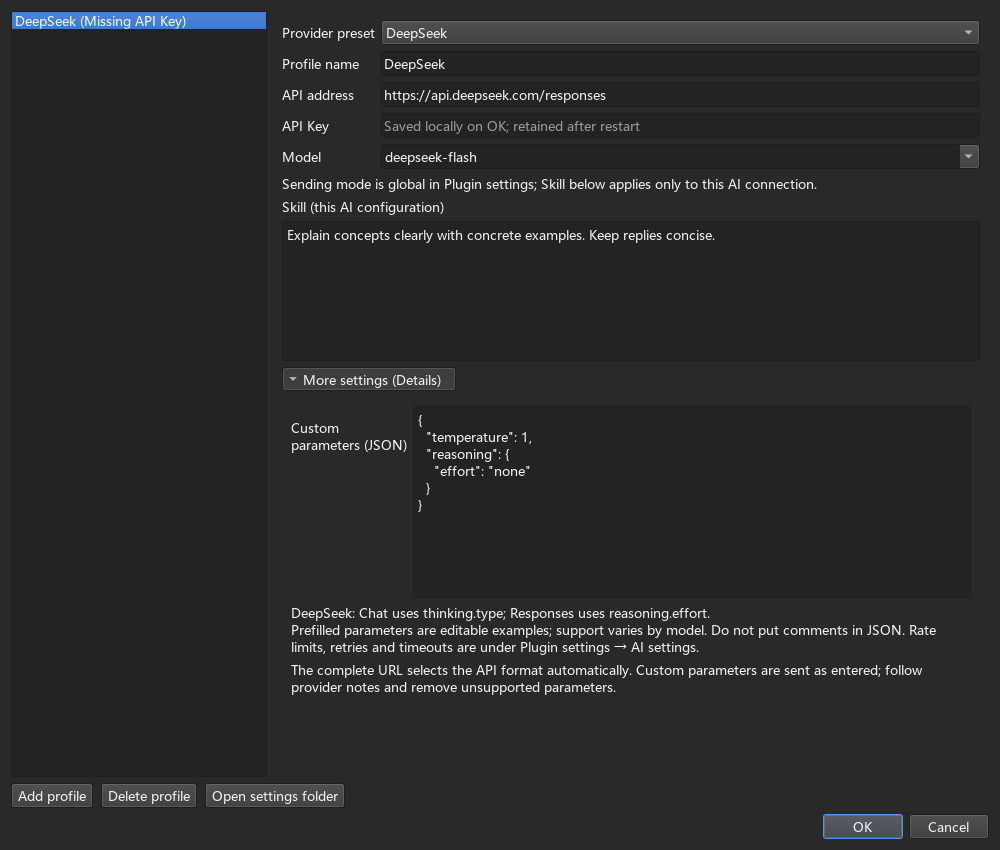
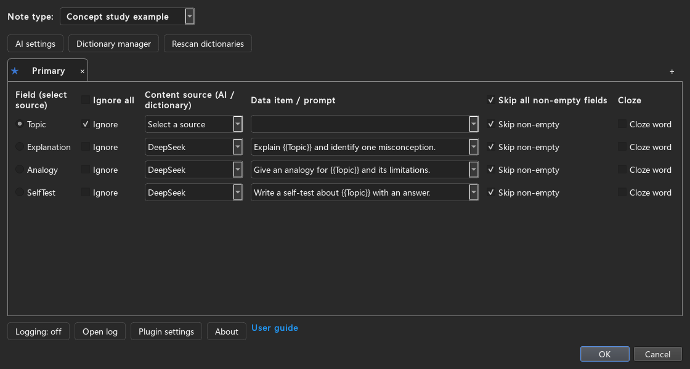
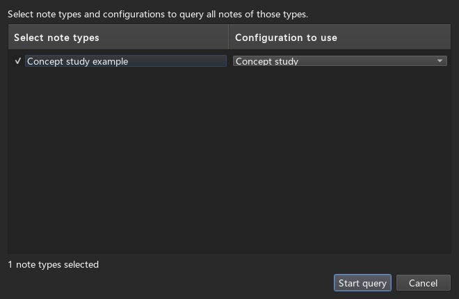
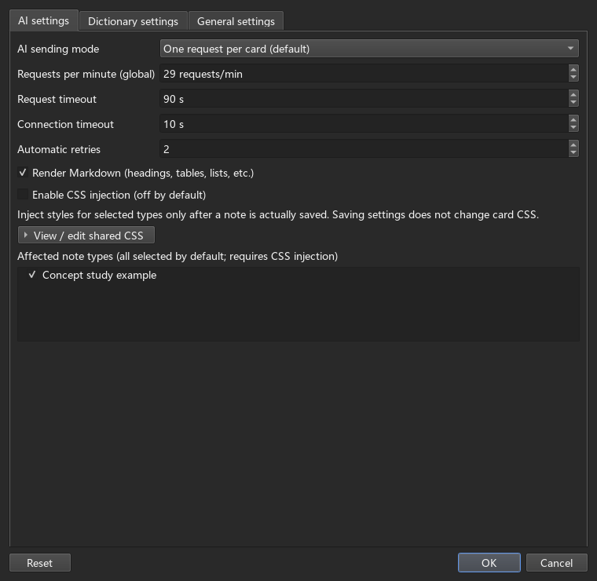
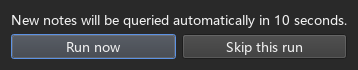
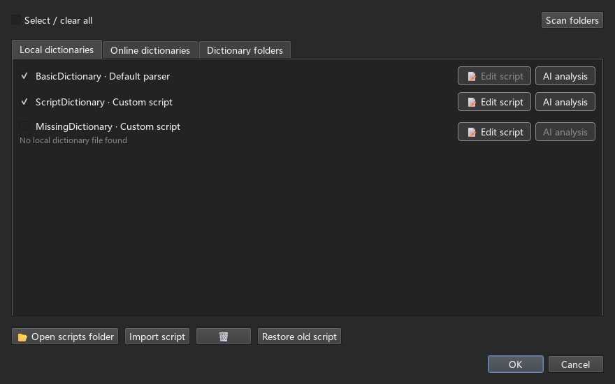
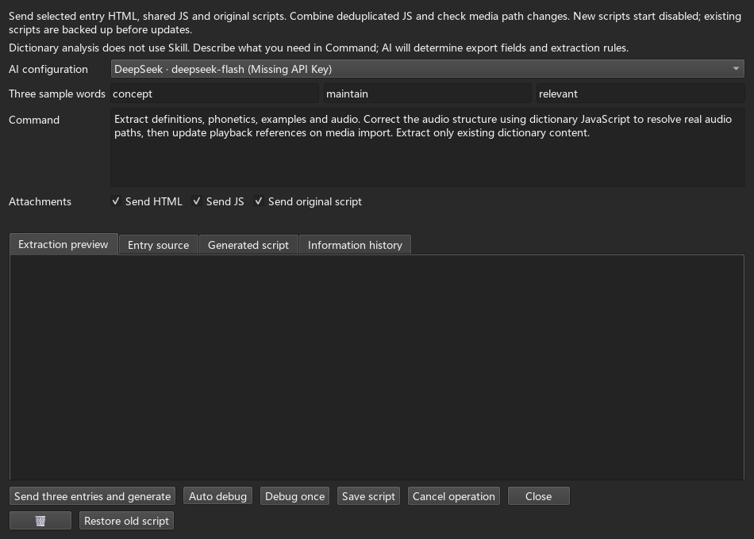
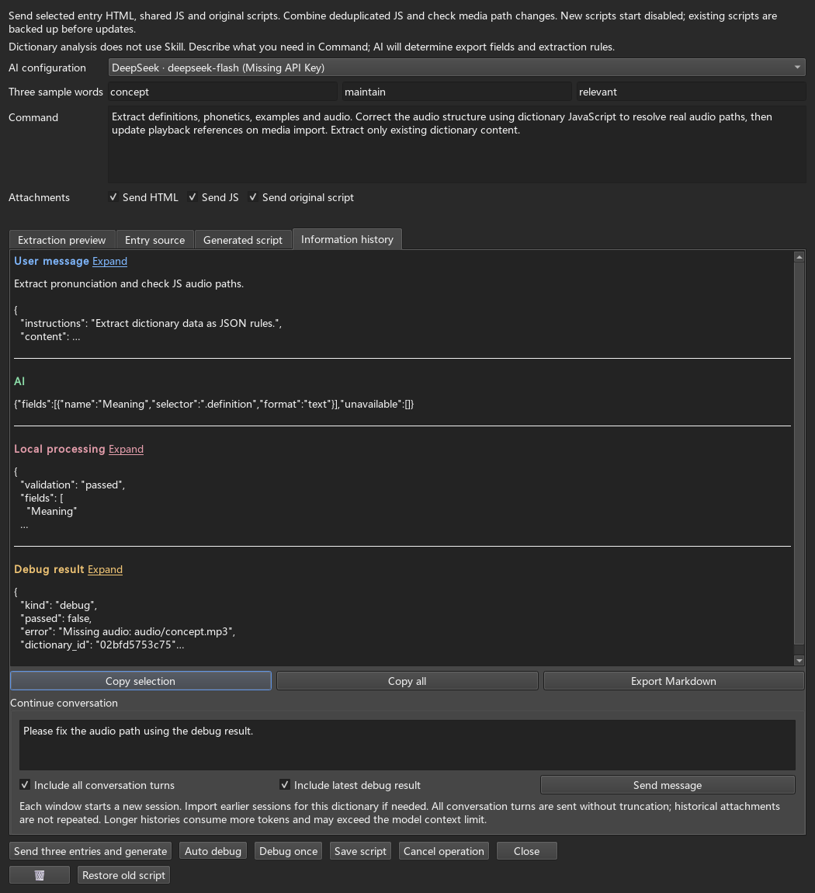
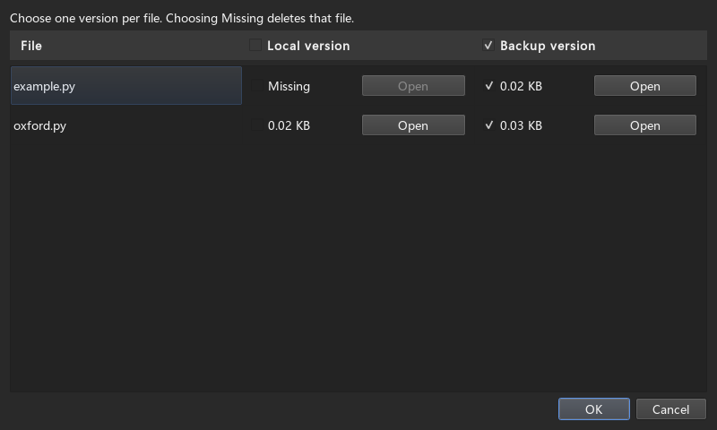

# FastCard Maker Practical Guide

This add-on is based on [FastWordQuery (FastWQ)](https://github.com/sth2018/FastWordQuery), with the original author credits and license retained.

[简体中文](usage.zh-CN.md)

Follow these steps to configure AI or dictionaries and process your notes. The screenshots use example fields, dictionaries and models; use your own settings.

For your first run, connect AI, configure fields, then test a few notes. AI and dictionaries work independently, or you can use different sources for different fields in the same configuration.

## Create cards with AI

### 1. Prepare notes and connect AI

Add notes in Anki and fill in a topic, question or study material. For example, create `Topic`, `Question` and `Answer` fields, fill the first two, and leave Answer for AI. The plugin fills existing notes; Anki templates control the front and back of each card.

Open **FastCM → Options → AI settings**:

1. Add a connection profile and give it a name.
2. Enter the complete endpoint in **API address (including endpoint path)**, including its path, then enter the API key and model.
3. Enter the key and a model that supports this API, then click **OK**.
4. Optionally use **Skill** for shared instructions, such as “Answer concisely and include a concrete example.”



Example URLs: `https://api.deepseek.com/responses` or `https://maas.qianwenaiapi.com/compatible-mode/v1/responses`. Selecting a service preset fills its complete endpoint automatically; there is no API mode selector. OpenAI, DeepSeek and Qwen default to Responses, Gemini to the official Interactions API, and Claude to Messages. Enter a model that supports that API. Existing profiles keep their addresses; check custom parameters when changing an endpoint.

Qwen/Model Studio regions and workspaces may require dedicated domains, so use the complete endpoint from your console. Gemini parameters belong inside `generation_config` (for example `temperature: 1`, `thinking_level: "minimal"`); minimal does not disable thinking. Claude defaults to `max_tokens: 4096`, editable under More settings.

Open **More settings → Custom parameters (JSON)** to edit the examples or add supported parameters. For Responses:

```json
{
  "temperature": 1,
  "reasoning": {"effort": "none"},
  "top_p": 1
}
```

Temperature 1 and thinking disabled are editable examples, without automatic model filtering. DeepSeek Chat uses `"thinking":{"type":"disabled"}`; Qwen (including Responses) uses `"enable_thinking":false`. Follow the notes under the input, remove unsupported parameters and omit JSON comments. Top-level `content` support depends on the API; use the conversation input to ask “Continue the previous answer.”

Shared request rate, request/connection timeouts and retries are in **Plugin settings → AI settings**.

### 2. Select target fields and write prompts

Select the note type in Options, then configure its fields:

1. Use the radio button to select a source field, such as Topic.
2. Keep **Ignore** selected for fields you do not want to update.
3. Choose your AI connection for Answer, clear **Ignore**, and enter a prompt.
4. Click **OK** to save the field configuration.

Options reopens the last saved note type and viewed configuration tab, without changing the default used by Browser queries. Unsaved changes are discarded on exit.



One prompt can reference multiple fields:

```text
Using {{Topic}}, answer this question: {{Question}}
Give a direct answer followed by one example. Keep it under 150 words.
```

The plugin inserts values from the current note. Names must match your actual fields, and referenced fields must not be configured as AI outputs. Put field references in target-field prompts, rather than Skill.

For tables, ask directly for a Markdown comparison table. Different target fields can have different instructions.

### A complete example: learning a concept

1. Create Topic, Question, Answer and Comparison fields in Anki. Add a note with “Statistics” as Topic and “How do correlation and causation differ?” as Question.
2. Select this note type in Options and choose Topic as the source field. Keep Topic and Question unchanged; do not configure them as AI outputs.
3. Clear Ignore for Answer, choose your AI connection, and use the multi-field prompt above.
4. Clear Ignore for Comparison, select the same AI, and enter: `For {{Question}} within {{Topic}}, create a Markdown table comparing definitions, examples and common mistakes.`
5. Save, select just this note in the Browser, and query it. The results go to Answer and Comparison separately. If the back of the card does not show them, add these fields to the back template using Anki’s Cards… button.

For vocabulary, put a word in the source field and request meanings, examples or related words in separate target fields. Combined sending assigns replies to the target fields automatically; you do not need to write a JSON-splitting script.

### 3. Test selected notes, then process whole types

Select a few notes in Anki's Browser and click **FastCM → Query selected**. Inspect the generated content first.

When satisfied, open **FastCM → Query whole note types**:

1. Check the note types to process.
2. Choose a saved configuration for each type.
3. Click **Query** to process all notes of the selected types.



When opened from the Browser, types represented by selected notes are checked automatically. From Anki's home window, select them yourself. Save configuration changes before querying. To replace existing content, clear **Skip existing values** on the target field.

### 4. Set sending mode, table styles and background operation

Open **Plugin settings → AI settings**:

- **Combine by note:** the default; target fields on one note using the same AI connection share a request.
- **Send per field:** each target field gets its own request.
- **Markdown:** formats tables, lists and other Markdown in replies; enabled by default.
- **CSS injection:** enable it for table styles and select affected types in the always-visible list. Only the stylesheet editor is folded; click **View / edit shared CSS** to expand it. Injection is off by default and applies after content is actually updated for a selected type.

Use **Dictionary settings** for dictionary workers and matching; use **General settings** for language, cloze format and scheduled generation.



During a query, click **Run in background** to continue using Anki. Check **FastCM → Task progress**, inspect results when finished, and click **Finish task** to hide progress. Keep Anki open. Results are saved every 30 seconds, with remaining content saved at the end.

If a recovery dialog appears after restarting, click **Recover results** to apply cached output or **Later** to keep it for another time.

### 5. Optional: schedule new-note processing

Star the desired configuration in Options and save. Choose one automatic configuration for each note type.

In **Plugin settings → General settings**, enable scheduling, set an interval such as five minutes, select note types and save. It fills empty fields of notes added after enabling the feature. An active batch causes the next tick to be skipped.

When notes are ready, a top prompt counts down **10 seconds**. Click **Run now**, **Skip this run**, or wait to start automatically. Closing the prompt skips this tick. Automatic tasks do not show an extra completion notification; check Task progress. Keep Anki open.



### 6. Synchronize or read configuration

Opening **FastCM → Options** compares local settings with the copy in the media folder. A prompt appears only when they differ; expand its details to see the changed settings:

- **Overwrite:** replace the media-folder copy with this device’s settings.
- **Sync:** read the media-folder copy into this device.
- **Cancel:** keep both copies and continue using local settings. Subsequent edits stay local until the difference is resolved.

Field mappings, AI connections, parameters and CSS are stored in `_fastcmcfg.json` in the media folder. The working local copy is `_fastcm_local.json` in the current profile. Dictionary folders and machine-specific paths remain local. API keys are stored locally in `fastcm/ai/config.json`; the General settings switch controls whether they are also included in shared configuration, enabled by default.

To import an existing JSON configuration, open **Plugin settings → General settings → Read configuration**. The file picker starts in the media folder, allows other locations, and filters for JSON files. Confirming loads settings locally and refreshes field configuration, while keeping local dictionary paths and keys. On the next Options opening, choose whether to overwrite the media-folder copy. There is no manual backup button.

Set dictionary folders separately on each computer. Missing dictionaries are never silently replaced with another source.

## Dictionaries and parser scripts

### 1. Add dictionaries and map fields

1. Add a folder in **Dictionary manager → Dictionary folders**. Keep associated MDD files and resources with your MDX dictionaries.
2. Enable the desired sources under **Local dictionaries** or **Online dictionaries**, then save.
3. In Options, choose the field containing the word as the source. Choose a dictionary and data item for each target, clear **Ignore**, and save.
4. Query a few selected notes before processing whole note types.



If a dictionary moves, restore its path and rescan. Unavailable sources are not automatically replaced. Use default parsing for complete entries, or a script for separate meaning, example or pronunciation items.

### 2. Generate or revise a parser with AI

Click **AI parse** beside the dictionary:

1. Select a configured AI connection. Parsing uses your Command, without the connection's Skill.
2. Keep the three default samples or enter three different words from the dictionary.
3. Describe the output in **Command**, for example “Extract meanings, phonetics and pronunciation separately; check whether JS changes audio paths.”
4. Select **Send HTML**, **Send JS** and **Send original script** as needed. Send HTML and JS for audio-path repairs; include the original script when revising one.
5. Click **Send three entries and generate**, inspect the extraction preview and generated script, then click **Save script**.
6. Enable the dictionary in Dictionary manager, then select its data items in Options and save.



### 3. Debug and continue the conversation

Enable **Auto debug** before generation or click **Debug once** afterward. Read results in **Information history**; expand failures to inspect the word, field and error. Debugging does not change cards and covers only the generated export methods and three samples. Test a few notes after saving.



- Enter a follow-up in the input below and click **Send message**, such as “Fix audio paths using the debug errors and keep the other fields.”
- Select **Include all conversation turns** for context and **Include latest debug result** for error-based repairs.
- Messages initially show up to five lines. Use **Expand / Collapse** to read them. Use **Copy all** or **Export Markdown** to share full records.
- After an AI revision, inspect the preview and **Save script** again. Use **Restore old script** to undo a script change; recycled backups are kept for seven days.

History and source attachments increase token usage and may exceed the model limit. If needed, disable history or start a new session. 


## Common tasks and fixes

- **Nothing was filled:** check that the target is not ignored, the correct source is selected, and Skip existing values is not skipping its current content. Open Task progress for failure details.
- **Regenerate one field:** clear Skip existing values for that field and ignore other targets. Save, select a few notes, and query again. Regeneration replaces the target’s previous content.
- **Changes seem to have no effect:** save both the AI connection dialog and the main Options dialog with OK, then select that saved configuration in the whole-type query dialog.
- **Connection or parameter error:** check the key, model, complete endpoint. If the API rejects a parameter, remove it from the JSON under More settings and retry.
- **Missing dictionary content or audio:** restore the MDX, associated MDD and resource paths, then rescan. For dictionaries whose JS changes audio paths, send both HTML and JS when generating a parser, then debug and test a few notes.
- **Background window disappeared:** reopen FastCM → Task progress. Minimizing keeps the task running; closing Anki stops further requests. Cached replies can be recovered on the next launch.


### Script backup and recovery

Bundled, imported and AI-generated Python dictionary parsers are backed up to `_fastcm_scripts.zip` in the media folder and sync with Anki media. Runtime copies live in `fastcm/scripts` within the current Anki profile. Dictionary JavaScript stays with the dictionary; select Send JS when AI analysis needs it. Folder scans no longer import adjacent Python files. Use **Dictionary manager → Import script** instead.

Opening Options checks script content fingerprints. If versions differ, entering dictionary or AI settings shows a file chooser with **Local version / Backup version**, defaulting to Backup. Header checkboxes select an entire side; individual rows can then be changed. Each side shows its size and **Open**, which displays read-only source inside the add-on without executing it. Selecting a missing side deletes the file, with confirmation. If no ZIP exists, current scripts create the first backup. Matching copies update automatically when a script is saved; differing copies require a choice.

Parsers identify MDX files by filename stem and internal title, rather than absolute paths. Re-add a moved dictionary folder and rescan. Multiple matching files require you to adjust imported folders; the first match is never silently chosen. Removing a folder preserves scripts and field mappings.



### Saving settings and API keys

Settings keep an opening snapshot in memory. Closing, Cancel or Esc exits immediately if values match; otherwise choose **Save / Discard / Cancel**. Changing a value back does not count as an edit. FastCard Maker settings take precedence; when absent, legacy FastWQ settings are read. Subsequent saves write `_fastcmcfg.json`, preserving the old file.

**Plugin settings → General settings → Include API keys in backup** is enabled by default. Keys are stored as plaintext in the shared JSON and sync with media. Disable it to remove keys from shared settings while retaining local credentials. Restored connections without a key display “Missing API Key”; enter the key to use them. AI chat and debug messages remain in the current window only and are not automatically saved to disk or included in the ZIP.
