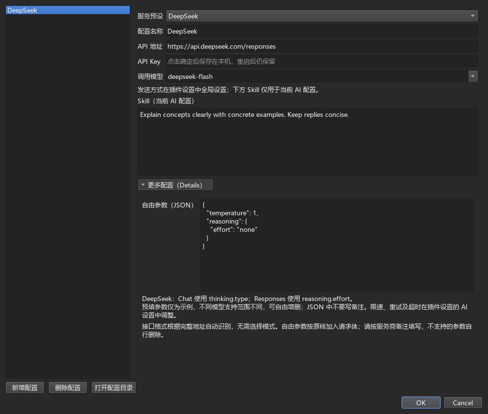
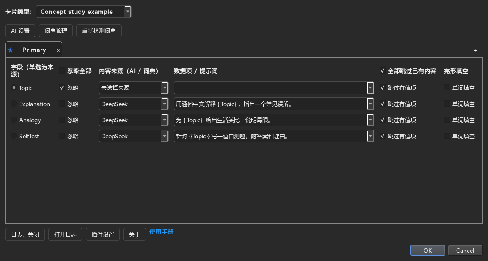
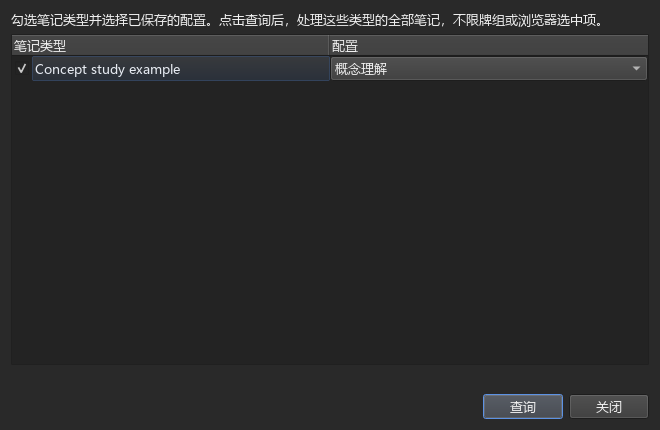
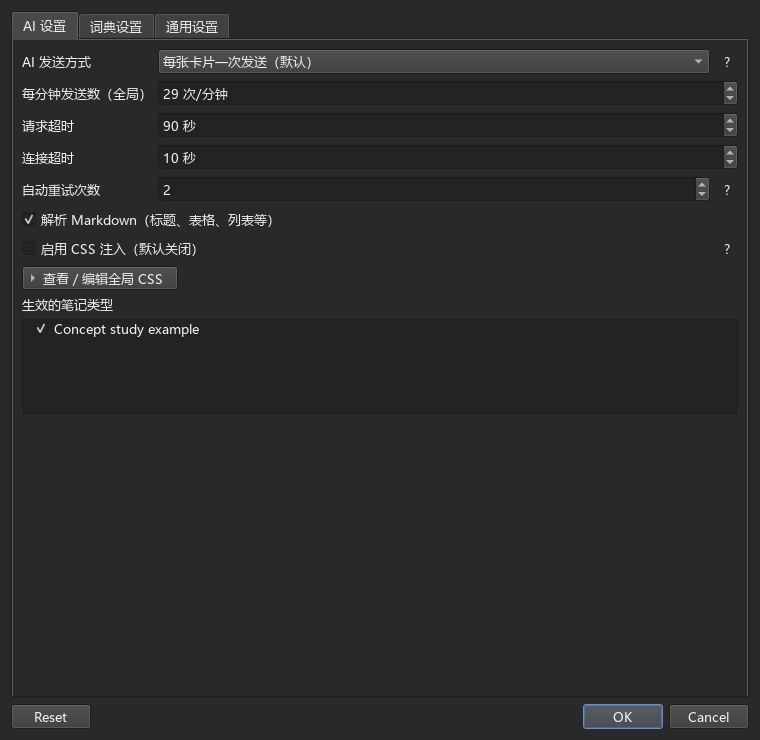
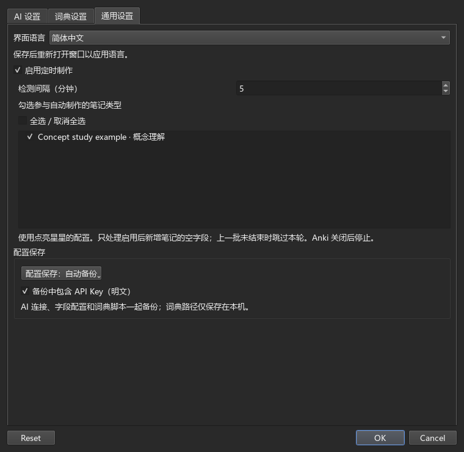
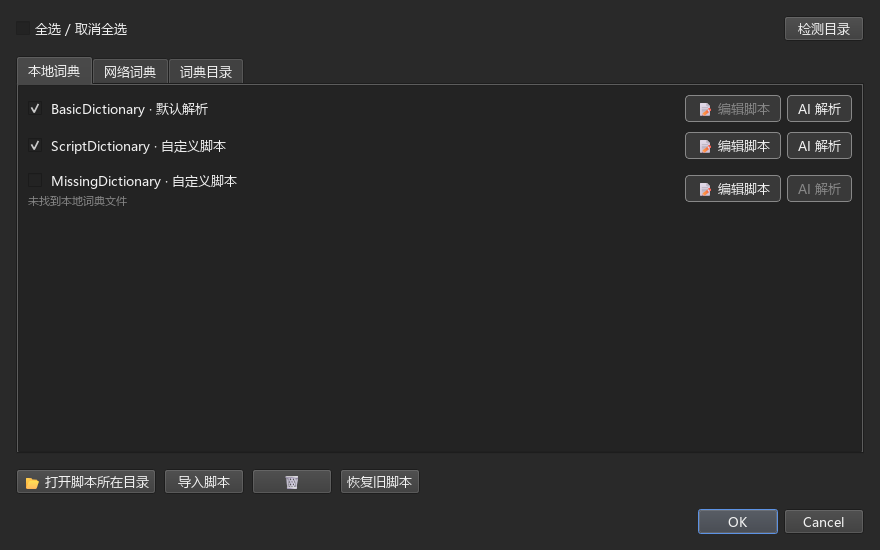
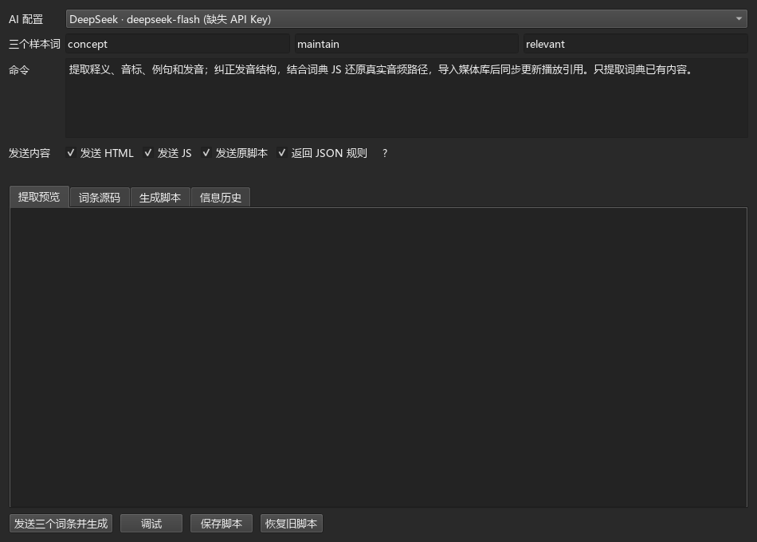
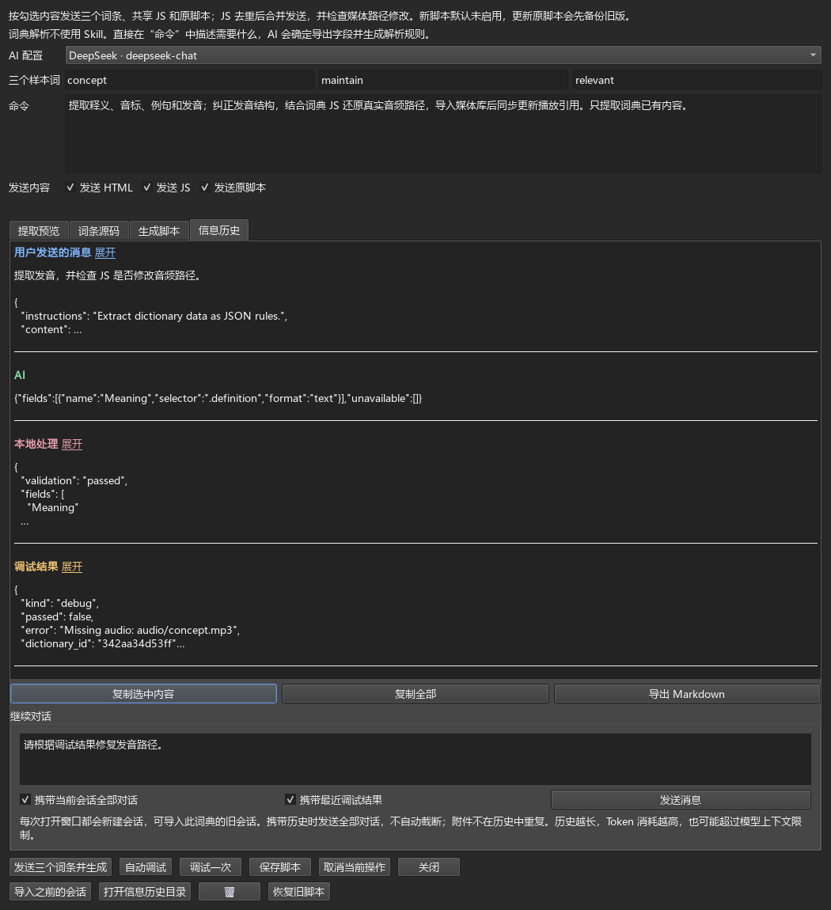
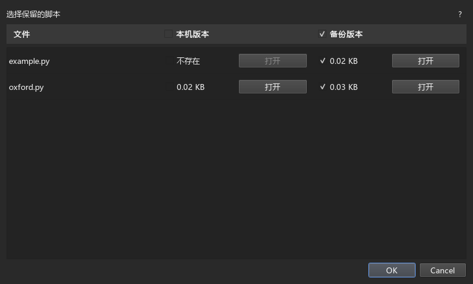

# FastCard Maker 使用说明

本插件基于 [FastWordQuery（FastWQ）](https://github.com/sth2018/FastWordQuery) 开发，保留原项目的作者署名与许可证。

FastCard Maker 可以用 AI 为笔记补充解释、例子和对比表格，也可以从本地 MDX 词典或网络词典中提取内容。两种方式可以分别使用，也可以为同一条笔记的不同字段选择不同来源。

以下先介绍 AI 制卡，再介绍词典查询。建议先选几条笔记试用，确认结果符合要求后再批量处理。截图中的字段名、词典和模型仅作示例。

## 一、使用 AI 制卡

### 1. 添加 AI 配置

打开 **FastCM → 选项 → AI 设置**：

1. 点击 **新增配置**，选择 **服务预设**。插件内置 OpenAI（ChatGPT）、Claude、Gemini、DeepSeek 和 Qwen（通义千问）的接口地址与参数示例。
2. 为这份配置取一个便于识别的名称。使用其他兼容服务时，选择自定义，填写地址和模型名称，并选择 **接口格式**：Chat Completions、Responses 或 Messages。标准接口路径可自动识别；特殊路径按你选择的格式发送，必须与服务器实际支持的格式一致。
3. 填写 **API 地址、API Key 和调用模型**。API 地址需要包含接口路径，例如 `https://api.deepseek.com/responses`；预设填入的地址也可以修改。请使用所选服务支持的模型名称。
4. 如果希望这个 AI 始终遵守某些要求，可在 **Skill** 中填写，例如“使用中文解释，回答简洁，并给出具体例子”。填写完成后点击 **确定** 保存。



打开 **更多配置 → 自由参数（JSON）** 可以设置思考强度。DeepSeek 和 Qwen 都默认使用 **Responses**，新建配置时预填 `reasoning.effort` 为 `none`，表示关闭思考。是否允许关闭、支持哪些档位，以具体模型为准。

这里添加的 AI 配置也可以用于词典脚本解析。建议另建一份名为“词典解析”的配置；需要分析较复杂的脚本时，可以尝试较高的思考强度。下表只列出思考相关设置，可用对应示例替换自由参数；点击服务名称可查看官方文档。

| 服务及接口 | 较高思考强度的 JSON 示例 |
| --- | --- |
| [OpenAI（Responses）](https://developers.openai.com/api/docs/guides/reasoning) | `{"reasoning":{"effort":"high"}}` |
| [DeepSeek（Responses）](https://api-docs.deepseek.com/guides/responses_api/) | `{"reasoning":{"effort":"high"}}` |
| [Qwen／百炼（Responses）](https://help.aliyun.com/zh/model-studio/qwen-api-via-openai-responses) | `{"reasoning":{"effort":"high"}}` |
| [Claude（Messages，支持自适应思考的模型）](https://platform.claude.com/docs/en/build-with-claude/adaptive-thinking) | `{"thinking":{"type":"adaptive"},"output_config":{"effort":"high"},"max_tokens":16000}` |
| [Gemini（Interactions）](https://ai.google.dev/api/interactions-api-v1) | `{"generation_config":{"thinking_level":"high"}}` |

这些写法需要所选模型支持，`high` 在不同服务中也不代表相同的思考预算。Claude 示例保留了接口要求的 `max_tokens` 输出上限，可按需要调整；旧模型的思考设置请查阅官方文档。较高思考强度通常会增加等待时间和 Token 用量，参数报错时可点击 **?** 查看说明。

Qwen 新建配置默认使用百炼北京地域的 `https://dashscope.aliyuncs.com/compatible-mode/v1/responses`。地域或业务空间不同可能需要其他地址，请以自己的控制台为准；已有配置中的地址不会自动替换。

### 2. 选择字段并填写提示词

先在 Anki 中准备好笔记。以学习概念为例，可以建立“主题”“问题”“回答”“对比”四个字段：在前两个字段中填写“统计学”和“相关与因果有什么区别？”，后两个留给 AI 填写。

回到 **FastCM → 选项**，选择这份笔记所属的 **笔记类型**：

1. 用左侧单选按钮把“主题”设为来源字段。
2. “主题”和“问题”不需要改写，保持勾选 **忽略**。
3. 取消“回答”的 **忽略**，将内容来源设为刚才保存的 AI，再填写提示词。
4. 如果还需要“对比”字段，也为它选择 AI 并填写自己的提示词。最后点击 **确定** 保存。



提示词可以引用多个字段。例如，在“回答”这一行填写：

```text
结合{{主题}}，回答这个问题：{{问题}}
先直接回答，再举一个例子，不超过200字。
```

插件会把 `{{主题}}` 和 `{{问题}}` 替换成当前笔记中的内容。字段名必须与笔记中的名称完全一致；被引用的字段不要同时设为 AI 输出字段。字段引用写在这里的提示词中，不写在 Skill 中。

“对比”字段可以填写：`围绕{{主题}}中的{{问题}}，用 Markdown 表格比较定义、例子和常见误区。` 切换这一行使用的 AI 不会清除原有提示词。

学习单词时操作相同：来源字段填写单词，再让其他字段分别生成释义、例句或近义词。插件将结果写入已有笔记；如果卡片上看不到新增内容，需要在 Anki 的 **卡片…** 中把相应字段加入模板。

### 3. 先查询几条，再批量处理

在 Anki 浏览器中选中几条笔记，点击 **FastCM → 查询选中项**，检查结果是否正确。

确认后，可以使用 **FastCM → 全类型查询**：勾选要处理的笔记类型，为每个类型选择已保存的配置，再点击 **查询**。



全类型查询会处理这些类型的**全部笔记**，不受当前牌组或浏览器选中范围限制。从浏览器打开时，会默认勾选已选笔记所属的类型；从首页打开时，默认不勾选任何类型。

如果某个字段已有内容，是否重新生成取决于该行的 **跳过有值项**。想重做这个字段时，取消该项；其他不需要处理的字段勾选 **忽略**。修改配置后先点击 **确定** 保存，再开始查询。

### 4. 调整发送方式和卡片样式

打开 **插件设置 → AI 设置**，可以调整以下选项：

- **每张卡片一次发送**：默认方式。同一笔记中使用同一 AI 配置的字段会合并为一次请求，收到回复后分别填入各字段。
- **每个字段分别发送**：每个目标字段单独向 AI 请求结果。
- **解析 Markdown**：把回复中的标题、列表和表格转换为卡片能显示的格式，默认开启。
- **启用 CSS 注入**：默认关闭。需要美化表格等内容时，开启此项并勾选需要使用样式的笔记类型。点击 **查看／编辑全局 CSS** 可以修改共用样式。插件会在对应类型的笔记实际写入内容后添加样式，只保存设置不会立即修改卡片。



每分钟发送数、连接超时、请求超时和重试次数也在此页调整。**词典设置**用于调整词典线程数、匹配方式和填空格式；**通用设置**用于调整语言、定时制作和备份方式。不清楚某项的作用时，点击旁边的 **?** 查看说明。

查询开始后，点击 **后台运行** 即可继续使用 Anki。从 **FastCM → 任务进度** 可以查看进度和结果；任务结束后点击 **完成任务** 收起进度栏。查询结果约每 30 秒写入一次，结束时会写入剩余结果。

关闭 Anki 会中断任务。下次启动时，如果出现恢复提示，可以点击 **恢复结果**，写入已经收到并缓存的内容；尚未完成的请求不会因此补回。

### 5. 自动处理新笔记（可选）

每个笔记类型默认使用第一份配置作为星标配置。需要更换时，在选项页点击另一份配置的星号并保存。

打开 **插件设置 → 通用设置**，勾选 **启用定时制作**，设置检测间隔、选择笔记类型，再点击 **确定**。插件只处理启用后新增笔记的空字段；如果上一批任务还没有结束，本轮会跳过。


发现待处理笔记后，顶部会出现 10 秒倒计时。可以点击 **立即运行** 或 **跳过本次**；关闭提示也会跳过，不操作则自动开始。请保持 Anki 打开，任务结束后从 **任务进度** 查看结果。

### 6. 保存、备份与换电脑使用

修改设置后点击 **确定** 保存。如果修改后直接关闭窗口，会询问是否保存；没有修改则直接关闭。

在 **插件设置 → 通用设置 → 配置保存** 中选择备份方式：

- **自动备份**：保存 AI 连接或当前词典脚本后，更新媒体文件夹中的 `_fastcm_backup.zip`，随 Anki 媒体同步。
- **手动备份**：AI 连接和脚本先保存在本机，需要时使用 **导入 ZIP／导出 ZIP**，文件选择框默认打开媒体文件夹。导出只包含已保存配置，未保存的修改需先点击 **确定**。导入会放弃当前设置页未保存的修改，确认框会提醒。



平时，AI 配置保存在本机的普通配置文件中，词典脚本仍是 `.py` 文件；备份时才将两者统一打包到 ZIP。字段映射、脚本启用勾选等普通配置保存到媒体库的 `_fastcmcfg.json`，不放进 ZIP，手动备份模式下也一样。词典文件路径仍仅存本机。

API Key 保存在本地，由系统统一管理，不会随配置上传或同步。

自动备份模式下，打开选项时如果发现配置不同，可以选择 **覆盖**（本机配置替换备份）、**同步**（备份读入本机）或 **取消**（暂时保留两边）。如果是脚本不同，会逐个文件让你选择保留哪一侧，详见下文。

备份不包含词典文件、词典路径、词典附带的 JS、对话记录和回收站中的旧脚本。换电脑后，还需要添加这台电脑上的词典文件夹。首次使用时优先读取本版配置，没有时尝试读取 FastWQ 旧配置，后续保存使用 FastCard Maker 的文件名。

## 二、使用词典和解析脚本

### 1. 添加词典并选择提取内容

1. 打开 **FastCM → 选项 → 词典管理 → 词典目录**，添加本地词典所在的文件夹。词典可以放在子文件夹中，配套 MDD 和资源文件需保持完整。
2. 回到 **本地词典**，勾选要使用的词典并保存。使用网络词典时，在 **网络词典** 中勾选相应项目即可。
3. 在选项页选择来源字段，例如“单词”；为目标字段选择词典和数据项，例如释义、例句或发音，取消 **忽略** 后保存。
4. 先选几条笔记查询，检查内容和媒体文件，再决定是否批量处理。



需要整条词条时可以选择默认解析；需要单独提取释义、例句或发音时，选择提供这些数据项的解析脚本。已有 `.py` 脚本请通过 **导入脚本** 添加，把它放在词典文件夹旁不会自动导入。

新版脚本优先按 **MDX 文件名**关联词典，内部标题可以作为补充条件，不需要保存本机的绝对路径。词典移动后，重新添加所在文件夹并检测即可。旧脚本中的固定路径和音频处理逻辑仍然兼容；同时提供文件名和旧路径时优先匹配文件名。如果出现多个匹配文件，需要调整导入目录，插件不会随意选一个。

词典或脚本失效时，管理页和选项页会给原名称加上删除线，查询时跳过，不会改用其他来源。管理页每行的 **删除** 按钮需要二次确认；缺失项会移除记录，仍在本机的脚本会移入回收站。选项页不提供删除按钮。失效的数据项请重新选择。

**图片或音频无法导入时**，先确认 MDD 和资源文件完整，再到 **词典设置** 尝试开启媒体资源模糊匹配，并检查导入结果。如果词典附带的 JS 修改了媒体路径，可以尝试下面的 AI 解析方法；缺失的媒体文件本身无法靠脚本补回。

### 2. 用 AI 生成或修改解析脚本

在词典旁点击 **AI 解析**。建议使用前面单独建立的“词典解析”AI 配置；需要提高思考强度时，按模型支持的参数设置。

1. 选择 AI 配置。默认三个样本词分别是名词 `concept`、动词 `maintain` 和形容词 `relevant`；找不到时会尝试备选词，也可以自行填写三个词典收录的不同词。
2. 在 **命令** 中直接描述要求，例如：“提取释义、音标和发音，检查 JS 是否修改音频路径，保留其他字段。”这里只使用你的命令，不使用 AI 配置中的 Skill。
3. 按需勾选 **发送 HTML、发送 JS、发送原脚本**。修复音频路径时建议发送 HTML 和 JS；修改已有脚本时同时发送原脚本。没有找到的附件不会发送。
4. 选择输出方式，再点击 **发送三个词条并生成**。检查 **提取预览** 和 **生成脚本**，需要时点击 **调试**。确认后点击 **保存脚本**，返回词典管理勾选启用，再为字段选择相应数据项。



**使用规则模式** 默认勾选：AI 返回解释与完整规则，由插件生成 Python，适合常规提取。取消勾选后，AI 返回解释与完整 Python，可以处理复杂路径或重新组织嵌套内容。两种模式都用 JSON 包装回复：解释放在 `ai-message`，修改内容分别放在 `rules` 或 `code`。只有消息时不修改脚本；有修改时先更新预览，确认后点击 **保存脚本** 才写入 `.py` 文件。

直接生成 Python 时，生成阶段只检查语法和结构。点击 **调试**，以及保存后加载脚本时，会执行代码；检查通过不代表运行结果一定正确。

### 3. 查看调试结果并继续修改

点击 **调试** 会一次检查三个样本，结果和错误详情都显示在 **信息历史**。如果有问题，在下方输入框说明需要怎样修改，再点击 **发送消息**。



- **携带全部消息**是默认选项；选择 **携带勾选的消息** 时，只携带右侧勾选的内容，新消息默认不勾选。用户与 AI 的消息按顺序作为历史对话发送；附加资料只携带最近一次 AI 回复后产生的本地处理和调试信息，旧资料留在页面供查看与复制，不再重复附带。相同脚本在历史与当前附件之间通过引用去重。两种选择对 **发送消息** 和再次 **发送三个词条并生成** 都生效。
- AI 的解释显示在回复最前面，支持 Markdown，隐藏 `ai-message` 字段名；后面显示剩余 JSON。同一条回复共用一个勾选框，复制和发送历史时保留完整原文，不会把解释重复发送。
- 每条消息显示时间，超过五行的内容默认折叠，点击消息后的 **展开／收起** 查看。勾选后可 **复制选中内容**，也可以 **复制全部** 或 **导出 Markdown**。
- **导入对话**可以选择 TXT 或 Markdown 文件，把已有对话作为参考。当前窗口的消息不会自动保存，需要保留时请在关闭前导出。

普通 AI 制卡不携带这里的历史对话。携带消息和源码会增加 Token 用量。对话过长时，可以只勾选有用的消息，或关闭窗口重新开始。AI 修改脚本后，需要再次检查并点击 **保存脚本**。

需要手动调整时，先保存脚本，再点击底部 **编辑脚本**，用文本编辑器打开对应的 `.py`。文件保存后，下次发送或调试会重新读取；若文件与未保存预览都改过，会提示先处理版本，避免覆盖修改。

### 4. 选择脚本版本和恢复旧脚本

自动备份模式下，如果本机脚本与 ZIP 备份不同，会显示文件列表，让你逐行选择 **本机版本**或**备份版本**，默认选择备份。表头勾选框可以全选一侧，再逐行调整。



每一侧都显示文件大小，点击 **打开**可只读查看源码，不会运行。选择显示“不存在”的一侧表示删除对应文件，确认前会再次提醒；不确定时可以关闭窗口，保留原状。

需要撤回脚本修改时，点击 **恢复旧脚本**，按文件名和删除时间选择版本，再点击 **恢复**；也可以先点击 **打开**查看。**这些旧脚本只保存在本机，不同步、不进入备份 ZIP，保留七天后自动清理。** 恢复后，它才作为当前脚本参与备份。
